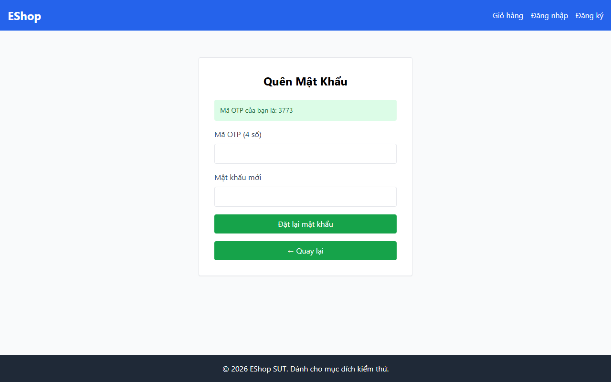

# TC-BVA-MATCH-002: Lệch Xác nhận Mật khẩu 1 Ký tự (Khoảng cách = 1)

## Requirement ID

FR-03 (Bước 2)

## Module / Test Type / Technique

PASSWORD-RESET-WEB / Functional / BVA

## Preconditions

- Mã OTP hợp lệ đã được tạo cho `test@eshop.com`.

## Test Data

| Field | Value |
|---|---|
| `otp` | `<Mã OTP hợp lệ>` |
| `new_password` | `Abc123@x` |
| `confirm_password` | `Abc123@y` (Lệch 1 ký tự duy nhất ở vị trí cuối) |

## Test Steps

1. Tại Bước 2, nhập mã OTP hợp lệ.
2. Nhập `Abc123@x` vào mật khẩu mới.
3. Nhập `Abc123@y` vào xác nhận mật khẩu.
4. Nhấn nút gửi.

## Expected Result

- Hệ thống từ chối yêu cầu do mật khẩu mới và xác nhận mật khẩu không khớp nhau.

## Actual Result

Giao diện Bước 2 thiếu trường "Xác nhận mật khẩu mới"; không thể kiểm thử hành vi lệch mật khẩu.

**Execution report observation:** Giao diện Bước 2 thiếu ô "Xác nhận mật khẩu mới"; không kiểm tra khớp.

## Evidence

## Test Design Rationale

Kiểm tra biên ngay ngoài điều kiện khớp (lệch đúng 1 ký tự).

## Status / Related Bugs

FAIL / DEF-FR03-07 — see [execution report](../../../reports/test-results/FR-03/bva_testing_report.md).
