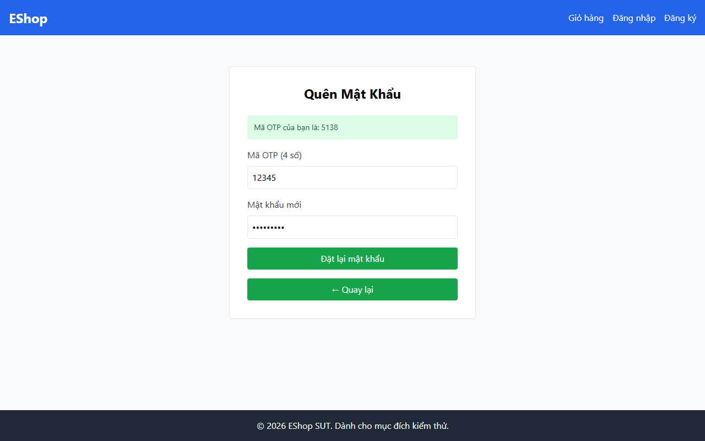

# TC-BVA-OTP-001: Độ dài OTP Dưới Biên (5 Chữ số)

## Requirement ID

FR-03 (Bước 2)

## Module / Test Type / Technique

PASSWORD-RESET-WEB / Functional / BVA

## Preconditions

- Người dùng đã đăng ký `test@eshop.com` đã thực hiện Bước 1 để lấy OTP.

## Test Data

| Field | Value |
|---|---|
| `email` | `test@eshop.com` |
| `otp` | `12345` (5 chữ số) |
| `new_password` | `ValidPass1!` |
| `confirm_password` | `ValidPass1!` |

## Test Steps

1. Điều hướng đến Bước 2 của quy trình đặt lại mật khẩu cho `test@eshop.com`.
2. Nhập mã OTP 5 chữ số `12345`.
3. Nhập mật khẩu mới hợp lệ và xác nhận mật khẩu.
4. Nhấn nút gửi ("Đặt lại mật khẩu").

## Expected Result

- Hệ thống từ chối yêu cầu do độ dài mã OTP không hợp lệ (phải chính xác 6 chữ số).
- Mật khẩu không bị thay đổi.

## Actual Result

Hệ thống từ chối OTP 5 chữ số ("12345") với alert: "Mã OTP không đúng hoặc có lỗi xảy ra.".

**Execution report observation:** Từ chối OTP 5 chữ số với alert: "Mã OTP không đúng hoặc có lỗi xảy ra.".

## Evidence

## Test Design Rationale

Kiểm tra giá trị biên ngay dưới yêu cầu 6 chữ số (`6 - 1 = 5`).

## Status / Related Bugs

PASS / Không có — see [execution report](../../../reports/test-results/FR-03/bva_testing_report.md).
