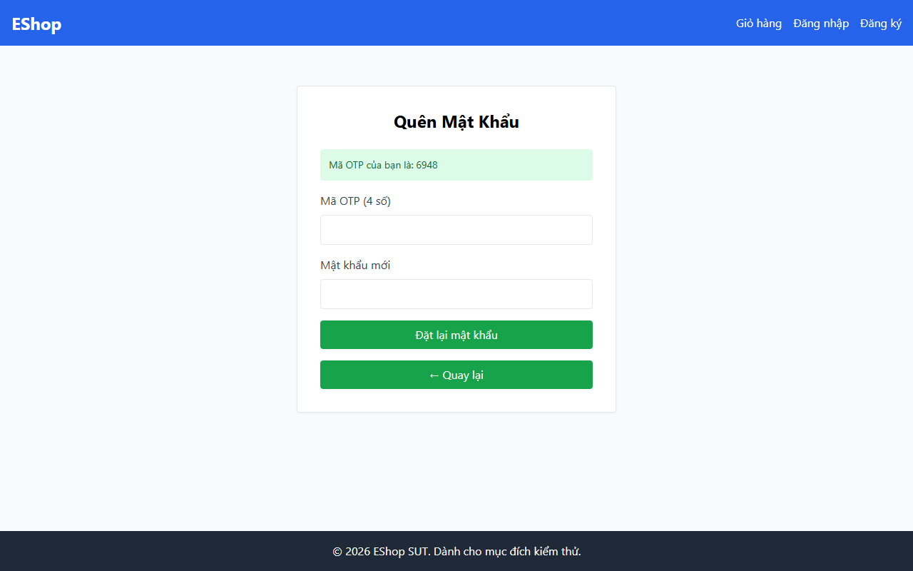

# TC-BVA-OTP-002: Độ dài OTP Tại Biên (6 Chữ số)

## Requirement ID

FR-03 (Bước 1, Bước 2)

## Module / Test Type / Technique

PASSWORD-RESET-WEB / Functional / BVA

## Preconditions

- Người dùng đã đăng ký `test@eshop.com` đã thực hiện Bước 1.
- Mã OTP 6 chữ số đã được tạo cho `test@eshop.com`.

## Test Data

| Field | Value |
|---|---|
| `email` | `test@eshop.com` |
| `otp` | `<Mã OTP 6 chữ số được tạo>` |
| `new_password` | `ValidPass1!` |
| `confirm_password` | `ValidPass1!` |

## Test Steps

1. Tại Bước 1, nhập `test@eshop.com` và nhận mã OTP được tạo.
2. Tại Bước 2, nhập chính xác mã OTP 6 chữ số.
3. Nhập mật khẩu mới hợp lệ và xác nhận mật khẩu.
4. Nhấn nút gửi.

## Expected Result

- Hệ thống chấp nhận mã OTP 6 chữ số.
- Đặt lại mật khẩu thành công; người dùng có thể đăng nhập bằng `ValidPass1!`.

## Actual Result

Backend chỉ tạo mã OTP 4 chữ số (server.js:72). Nhãn giao diện ghi rõ "Mã OTP (4 số)". Hệ thống không sinh và không chấp nhận mã OTP 6 chữ số theo đặc tả.

**Execution report observation:** Backend chỉ tạo mã OTP 4 số; nhãn UI ghi "Mã OTP (4 số)"; không hỗ trợ mã 6 chữ số.

## Evidence

## Test Design Rationale

Kiểm tra đúng ngưỡng 6 chữ số theo yêu cầu của FR-03.

## Status / Related Bugs

FAIL / DEF-FR03-01 — see [execution report](../../../reports/test-results/FR-03/bva_testing_report.md).
