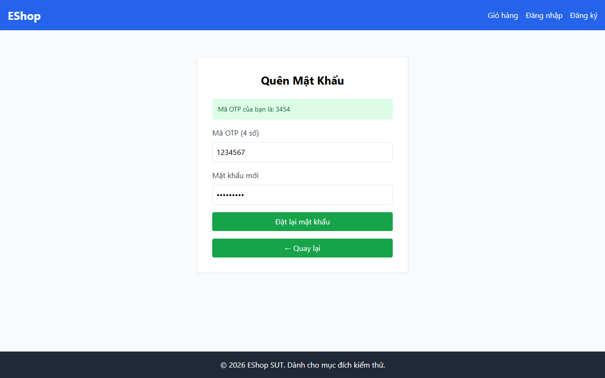

# TC-BVA-OTP-003: Độ dài OTP Trên Biên (7 Chữ số)

## Requirement ID

FR-03 (Bước 2)

## Module / Test Type / Technique

PASSWORD-RESET-WEB / Functional / BVA

## Preconditions

- Người dùng đã đăng ký `test@eshop.com` đã thực hiện Bước 1.

## Test Data

| Field | Value |
|---|---|
| `email` | `test@eshop.com` |
| `otp` | `1234567` (7 chữ số) |
| `new_password` | `ValidPass1!` |
| `confirm_password` | `ValidPass1!` |

## Test Steps

1. Tại Bước 2, nhập mã OTP 7 chữ số `1234567`.
2. Nhập mật khẩu mới hợp lệ và xác nhận mật khẩu.
3. Nhấn nút gửi.

## Expected Result

- Hệ thống từ chối yêu cầu do độ dài mã OTP không hợp lệ.
- Mật khẩu không bị thay đổi.

## Actual Result

Hệ thống từ chối OTP 7 chữ số ("1234567") với alert: "Mã OTP không đúng hoặc có lỗi xảy ra.".

**Execution report observation:** Từ chối OTP 7 chữ số với alert: "Mã OTP không đúng hoặc có lỗi xảy ra.".

## Evidence

## Test Design Rationale

Kiểm tra giá trị biên ngay trên yêu cầu 6 chữ số (`6 + 1 = 7`).

## Status / Related Bugs

PASS / Không có — see [execution report](../../../reports/test-results/FR-03/bva_testing_report.md).
