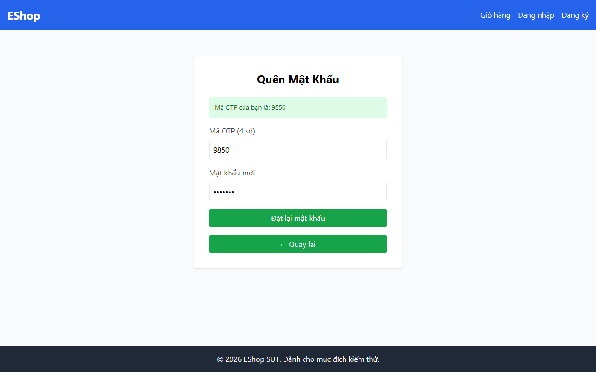

# TC-BVA-PW-LEN-001: Độ dài Mật khẩu Dưới Biên (7 Ký tự)

## Requirement ID

FR-03 (Bước 2), FR-01

## Module / Test Type / Technique

PASSWORD-RESET-WEB / Functional / BVA

## Preconditions

- Mã OTP hợp lệ đã được tạo cho `test@eshop.com`.

## Test Data

| Field | Value |
|---|---|
| `otp` | `<Mã OTP hợp lệ>` |
| `new_password` | `Abc12@x` (7 ký tự: 1 chữ hoa, 3 chữ thường, 2 chữ số, 1 ký tự đặc biệt) |
| `confirm_password` | `Abc12@x` |

## Test Steps

1. Điều hướng đến Bước 2.
2. Nhập mã OTP hợp lệ.
3. Nhập mật khẩu 7 ký tự `Abc12@x` vào cả hai trường mật khẩu mới và xác nhận mật khẩu.
4. Nhấn nút gửi.

## Expected Result

- Hệ thống từ chối yêu cầu với thông báo lỗi xác thực yêu cầu mật khẩu phải có ít nhất 8 ký tự.
- Mật khẩu không bị thay đổi.

## Actual Result

Chặn mật khẩu 7 ký tự thành công với alert: "Mật khẩu quá yếu! Phải dài tối thiểu 8 ký tự, gồm chữ hoa, chữ thường, số và KÝ TỰ ĐẶC BIỆT.".

**Execution report observation:** Chặn thành công với alert: "Mật khẩu quá yếu! Phải dài tối thiểu 8 ký tự...".

## Evidence

## Test Design Rationale

Kiểm tra ngưỡng độ dài số nguyên ngay dưới mức tối thiểu (`8 - 1 = 7`).

## Status / Related Bugs

PASS / Không có — see [execution report](../../../reports/test-results/FR-03/bva_testing_report.md).
