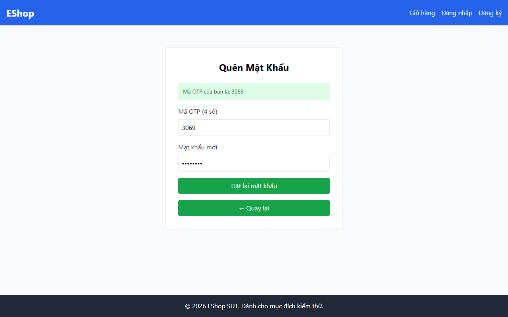

# TC-BVA-PW-LEN-002: Độ dài Mật khẩu Tại Biên (8 Ký tự)

## Requirement ID

FR-03 (Bước 2), FR-01

## Module / Test Type / Technique

PASSWORD-RESET-WEB / Functional / BVA

## Preconditions

- Mã OTP hợp lệ đã được tạo cho `test@eshop.com`.

## Test Data

| Field | Value |
|---|---|
| `otp` | `<Mã OTP hợp lệ>` |
| `new_password` | `Abc123@x` (8 ký tự: 1 chữ hoa, 3 chữ thường, 3 chữ số, 1 ký tự đặc biệt) |
| `confirm_password` | `Abc123@x` |

## Test Steps

1. Điều hướng đến Bước 2.
2. Nhập mã OTP hợp lệ.
3. Nhập mật khẩu 8 ký tự `Abc123@x` vào cả hai trường mật khẩu mới và xác nhận mật khẩu.
4. Nhấn nút gửi.

## Expected Result

- Hệ thống chấp nhận mật khẩu; đặt lại mật khẩu thành công.

## Actual Result

Mật khẩu đúng 8 ký tự hợp lệ "Pass123@" bị regex Client từ chối vì có ký tự "@" và thiếu khoảng trắng.

**Execution report observation:** Bị Client Regex chặn do có ký tự `@` và thiếu khoảng trắng; alert báo mật khẩu quá yếu.

## Evidence

## Test Design Rationale

Kiểm tra chính xác biên tối thiểu được bao gồm (`min = 8`).

## Status / Related Bugs

FAIL / DEF-FR03-05 — see [execution report](../../../reports/test-results/FR-03/bva_testing_report.md).
