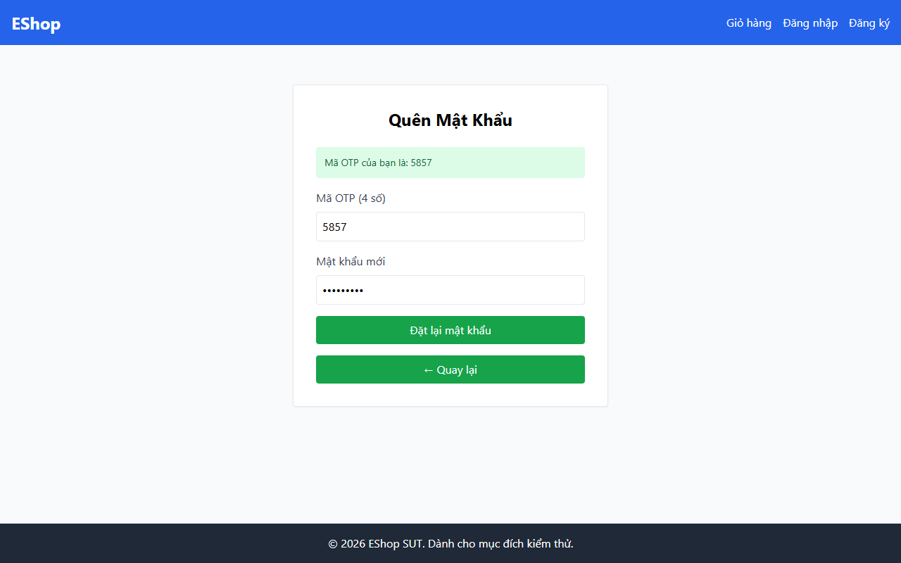

# TC-BVA-PW-LEN-003: Độ dài Mật khẩu Trên Biên (9 Ký tự)

## Requirement ID

FR-03 (Bước 2), FR-01

## Module / Test Type / Technique

PASSWORD-RESET-WEB / Functional / BVA

## Preconditions

- Mã OTP hợp lệ đã được tạo cho `test@eshop.com`.

## Test Data

| Field | Value |
|---|---|
| `otp` | `<Mã OTP hợp lệ>` |
| `new_password` | `Abc1234@x` (9 ký tự) |
| `confirm_password` | `Abc1234@x` |

## Test Steps

1. Điều hướng đến Bước 2.
2. Nhập mã OTP hợp lệ.
3. Nhập mật khẩu 9 ký tự `Abc1234@x` vào cả hai trường mật khẩu mới và xác nhận mật khẩu.
4. Nhấn nút gửi.

## Expected Result

- Hệ thống chấp nhận mật khẩu; đặt lại mật khẩu thành công.

## Actual Result

Mật khẩu đúng 9 ký tự hợp lệ "Passw123!" bị regex Client từ chối do ký tự "!" bị cấm bởi flawed regex.

**Execution report observation:** Bị Client Regex chặn do có ký tự `!` và thiếu khoảng trắng; alert báo mật khẩu quá yếu.

## Evidence

## Test Design Rationale

Kiểm tra độ dài danh định ngay trên ngưỡng tối thiểu (`8 + 1 = 9`).

## Status / Related Bugs

FAIL / DEF-FR03-05 — see [execution report](../../../reports/test-results/FR-03/bva_testing_report.md).
