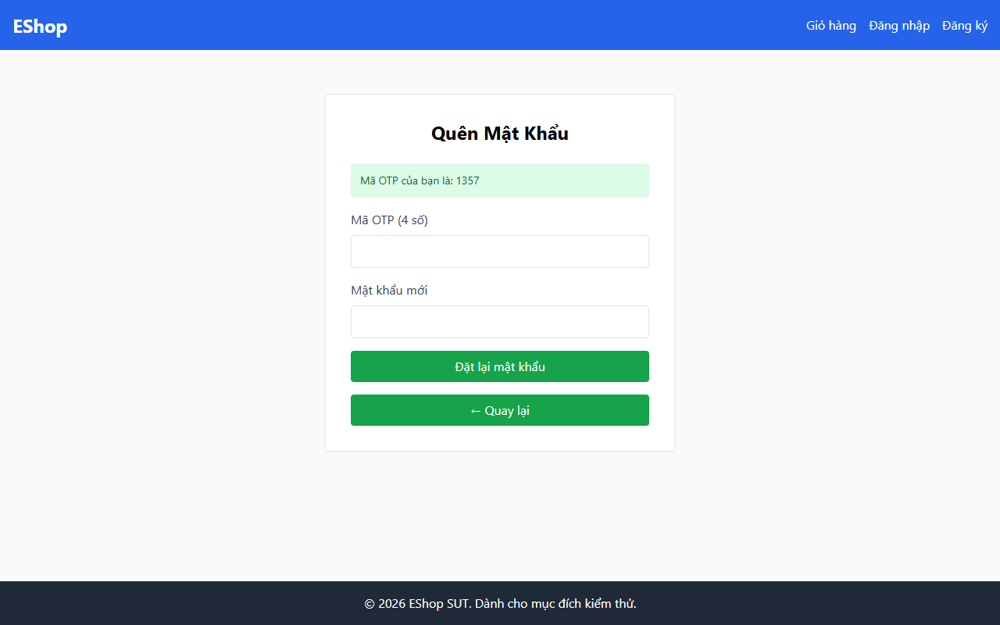

# TC-BVA-TRANS-001: Chuyển đổi Trạng thái từ Bước 1 sang Bước 2 (Kích hoạt Hợp lệ)

## Requirement ID

FR-03 (Bước 1)

## Module / Test Type / Technique

PASSWORD-RESET-WEB / Functional / BVA

## Preconditions

- Người dùng đang ở Bước 1 (`/forgot-password`).
- `test@eshop.com` đã được đăng ký.

## Test Data

| Field | Value |
|---|---|
| `email` | `test@eshop.com` |

## Test Steps

1. Điều hướng đến `/forgot-password`.
2. Nhập email đã đăng ký `test@eshop.com`.
3. Nhấn "Lấy mã OTP".

## Expected Result

- Trạng thái chuyển đổi từ Bước 1 sang Bước 2.
- Chỉ báo bước cập nhật hiển thị Bước 2/2.
- Mã OTP được hiển thị trên màn hình (môi trường demo).

## Actual Result

Chuyển sang Bước 2 thành công nhưng thiếu chỉ báo bước ("Bước 2 / 2") và OTP chỉ có 4 số.

**Execution report observation:** Chuyển sang Bước 2 thành công nhưng thiếu chỉ báo bước "Bước 2 / 2".

## Evidence

## Test Design Rationale

Kiểm tra biên chuyển đổi tích cực qua các giai đoạn của biểu mẫu.

## Status / Related Bugs

FAIL / DEF-FR03-01, DEF-FR03-04 — see [execution report](../../../reports/test-results/FR-03/bva_testing_report.md).
