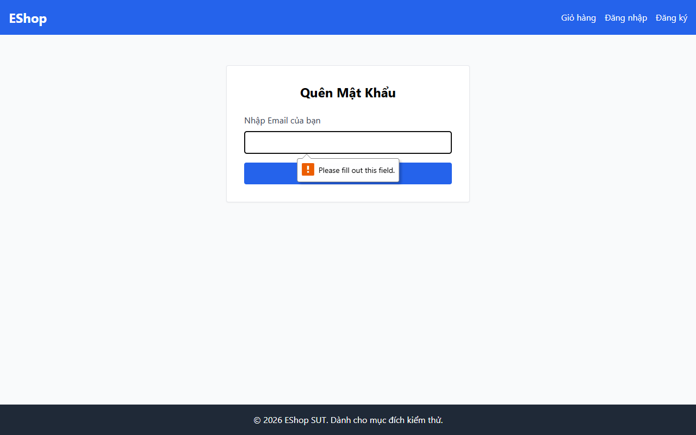

# TC-BVA-TRANS-002: Biên Chuyển đổi Trạng thái Bước 1 (Đầu vào Rỗng / Không hợp lệ)

## Requirement ID

FR-03 (Bước 1)

## Module / Test Type / Technique

PASSWORD-RESET-WEB / Functional / BVA

## Preconditions

- Người dùng đang ở Bước 1 (`/forgot-password`).

## Test Data

| Field | Value |
|---|---|
| `email` | `""` (Chuỗi rỗng) |

## Test Steps

1. Điều hướng đến `/forgot-password`.
2. Để trống trường email và nhấn "Lấy mã OTP".

## Expected Result

- Biểu mẫu KHÔNG chuyển sang Bước 2.
- Người dùng vẫn ở lại Bước 1 với thông báo lỗi xác thực hiển thị.

## Actual Result

Trình duyệt chặn gửi form khi ô email để trống nhờ thuộc tính HTML5 required; giữ nguyên ở Bước 1.

**Execution report observation:** Trình duyệt chặn submit nhờ thuộc tính HTML5 `required`; giữ nguyên Bước 1.

## Evidence

## Test Design Rationale

Kiểm tra biên chuyển đổi tiêu cực khi thiếu dữ liệu đầu vào chặn tiến trình chuyển bước.

## Status / Related Bugs

PASS / Không có — see [execution report](../../../reports/test-results/FR-03/bva_testing_report.md).
