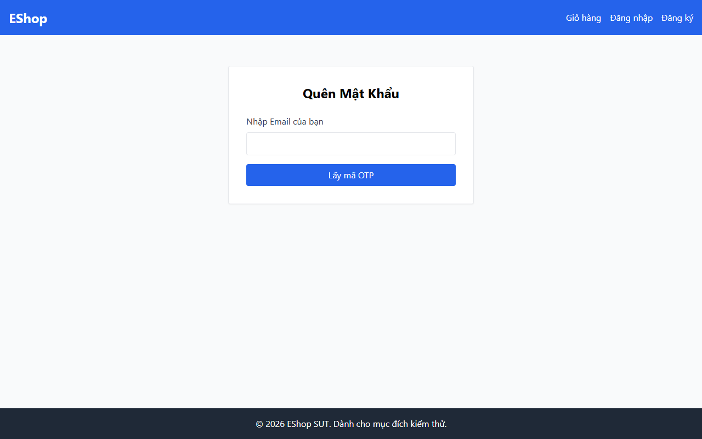

# TC-BVA-TRANS-003: Biên Điều hướng "Quay lại đăng nhập" ở Bước 1

## Requirement ID

FR-03 (Bước 1)

## Module / Test Type / Technique

PASSWORD-RESET-WEB / Functional / BVA

## Preconditions

- Người dùng đang ở Bước 1 (`/forgot-password`).

## Test Data

| Field | Value |
|---|---|
| Thao tác UI | Nhấn nút "Quay lại đăng nhập" |

## Test Steps

1. Điều hướng đến `/forgot-password` (Bước 1).
2. Tìm và nhấn nút "Quay lại đăng nhập".

## Expected Result

- Ứng dụng thoát khỏi luồng đặt lại mật khẩu và chuyển hướng điều hướng về `/login`.

## Actual Result

Giao diện Bước 1 không có nút hoặc liên kết "Quay lại đăng nhập" trong biểu mẫu.

**Execution report observation:** Giao diện Bước 1 không có nút hoặc liên kết "Quay lại đăng nhập".

## Evidence

## Test Design Rationale

Kiểm tra biên điều hướng thoát khỏi quy trình đặt lại mật khẩu.

## Status / Related Bugs

FAIL / DEF-FR03-03 — see [execution report](../../../reports/test-results/FR-03/bva_testing_report.md).
