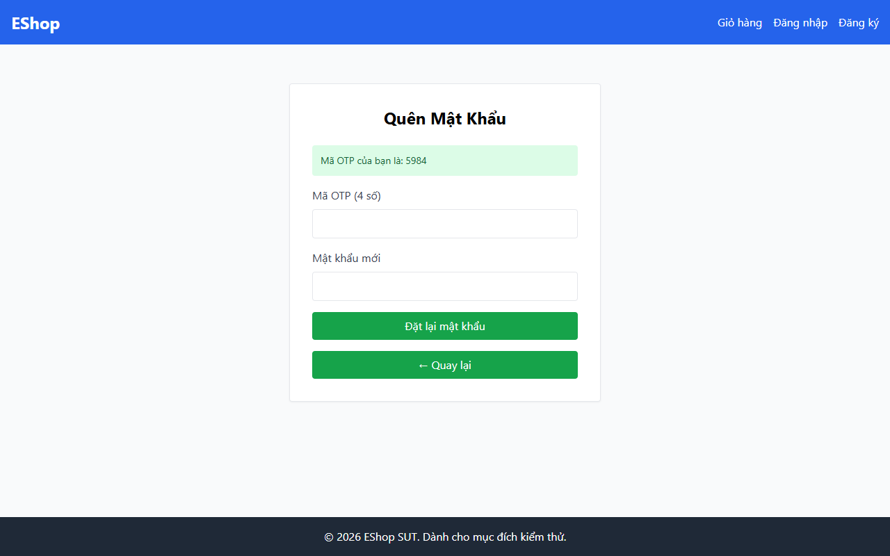

# TC-FORGOT-001: Bước 1 - Yêu cầu OTP với Email Hợp lệ đã Đăng ký

## Requirement ID

FR-03 (Bước 1)

## Module / Test Type / Technique

PASSWORD-RESET-WEB / Functional / Domain Testing

## Preconditions

- Người dùng `test@eshop.com` đã tồn tại trong cơ sở dữ liệu.

## Test Data

| Field | Value |
|---|---|
| `email` | `test@eshop.com` |

## Test Steps

1. Điều hướng đến trang `/forgot-password`.
2. Quan sát giao diện để kiểm tra Chỉ báo bước ("Bước 1 / 2" / "Step 1/2") và nút "Quay lại đăng nhập".
3. Nhập `test@eshop.com` vào ô email.
4. Nhấn nút "Lấy mã OTP".

## Expected Result

- Hệ thống sinh mã OTP 6 chữ số ngẫu nhiên.
- Mã OTP hiển thị trực tiếp trên màn hình (môi trường demo).
- Biểu mẫu chuyển sang Bước 2.

## Actual Result

OTP sinh ra có 4 chữ số (ví dụ: 5984) thay vì 6 chữ số theo đặc tả. Nhãn trường nhập liệu tại Bước 2 ghi "Mã OTP (4 số)". Giao diện hoàn toàn không có chỉ báo bước ("Bước 1 / 2").

**Execution report observation:** OTP sinh ra có 4 chữ số (`5984`). Không có chỉ báo bước. Nhãn ghi "Mã OTP (4 số)".

## Evidence

## Status / Related Bugs

FAIL / DEF-FR03-01, DEF-FR03-04 — see [execution report](../../../reports/test-results/FR-03/domain_testing_report.md).
