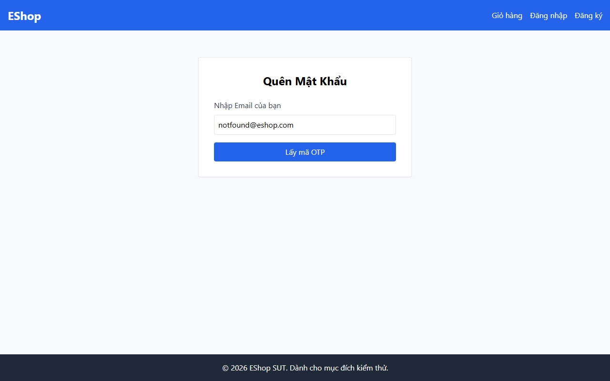

# TC-FORGOT-002: Bước 1 - Yêu cầu OTP với Email Chưa Đăng ký

## Requirement ID

FR-03 (Bước 1)

## Module / Test Type / Technique

PASSWORD-RESET-WEB / Functional / Domain Testing

## Preconditions

- Email `unregistered@eshop.com` không tồn tại trong cơ sở dữ liệu.

## Test Data

| Field | Value |
|---|---|
| `email` | `unregistered@eshop.com` |

## Test Steps

1. Điều hướng đến `/forgot-password`.
2. Nhập `unregistered@eshop.com`.
3. Nhấn "Lấy mã OTP".

## Expected Result

- Hệ thống trả về thông báo lỗi chỉ ra người dùng/email không tồn tại.
- Không sinh mã OTP; hệ thống không chuyển sang Bước 2.

## Actual Result

Hệ thống hiển thị alert lỗi: "Lỗi: User not found". Không sinh mã OTP và giao diện giữ nguyên ở Bước 1.

**Execution report observation:** Hệ thống hiển thị alert: "Lỗi: User not found". Giữ nguyên ở Bước 1.

## Evidence

## Status / Related Bugs

PASS / Không có — see [execution report](../../../reports/test-results/FR-03/domain_testing_report.md).
