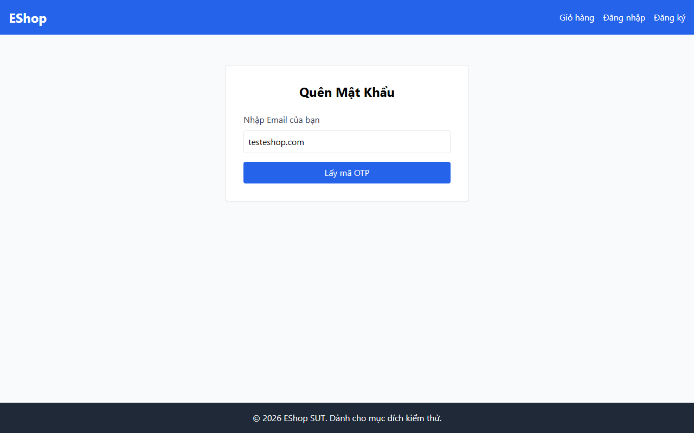

# TC-FORGOT-003: Bước 1 - Yêu cầu OTP với Email Sai Định dạng

## Requirement ID

FR-03 (Bước 1), FR-01

## Module / Test Type / Technique

PASSWORD-RESET-WEB / Functional / Domain Testing

## Preconditions

- Không có.

## Test Data

| Field | Value |
|---|---|
| `email` | `invalid-email-format` |

## Test Steps

1. Điều hướng đến `/forgot-password`.
2. Nhập `invalid-email-format`.
3. Nhấn gửi biểu mẫu.

## Expected Result

- Trình duyệt/form cảnh báo định dạng email không hợp lệ. Biểu mẫu không được gửi đi.

## Actual Result

Thẻ input email ở Bước 1 sử dụng type="text" thay vì type="email". Trình duyệt không kích hoạt validation HTML5; request được gửi lên backend và trả về alert: "Lỗi: User not found".

**Execution report observation:** Input là `type="text"`; form không chặn HTML5; gửi request và nhận alert: "Lỗi: User not found"

## Evidence

## Status / Related Bugs

FAIL / DEF-FR03-02 — see [execution report](../../../reports/test-results/FR-03/domain_testing_report.md).
