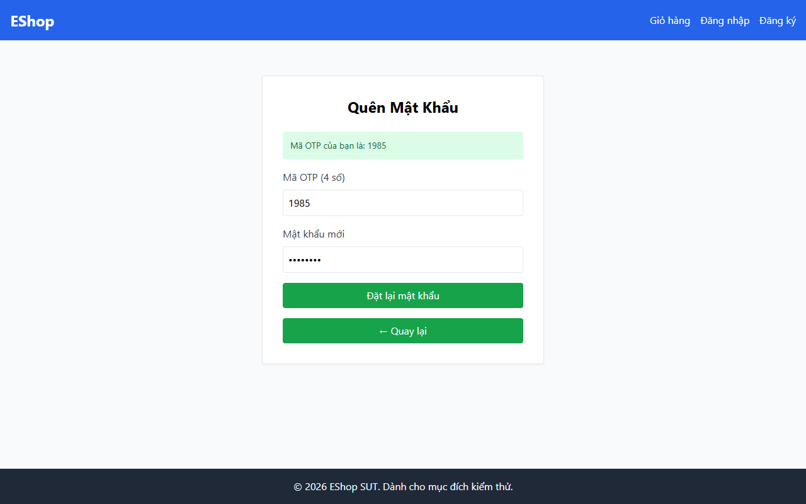

# TC-FORGOT-005: Bước 2 - Đặt lại Mật khẩu với Đúng 8 Ký tự Tối thiểu

## Requirement ID

FR-03 (Bước 2), FR-01

## Module / Test Type / Technique

PASSWORD-RESET-WEB / Functional / Domain Testing

## Preconditions

- Đã yêu cầu OTP cho `test@eshop.com` ở Bước 1.

## Test Data

| Field | Value |
|---|---|
| `otp` | `<Mã OTP 6 chữ số được tạo>` |
| `new_password` | `Abc123@!` (8 ký tự) |
| `confirm_password` | `Abc123@!` (8 ký tự) |

## Test Steps

1. Tại Bước 2, nhập mã OTP 6 chữ số hiển thị ở Bước 1.
2. Nhập `Abc123@!` vào ô "Mật khẩu mới".
3. Nhập `Abc123@!` vào ô "Xác nhận mật khẩu mới".
4. Nhấn "Đặt lại mật khẩu".
5. Điều hướng đến `/login` và đăng nhập thử bằng `test@eshop.com` và `Abc123@!`.

## Expected Result

- Đặt lại mật khẩu thành công.
- Người dùng đăng nhập thành công trên `/login` với `Abc123@!`.

## Actual Result

Execution was recorded as rejected by the client regex with the weak-password alert described in the detailed execution report.

### Execution input discrepancy

- This case draft lists `Abc123@!`; the detailed execution report lists `Pass123@`.
- The screenshot masks the password and does not independently confirm which value was entered.
- Both values are eight characters and belong to the designed valid class. Keep the recorded FAIL outcome, and confirm the exact input during retest.

## Evidence

## Status / Related Bugs

FAIL / DEF-FR03-05 — see [execution report](../../../reports/test-results/FR-03/domain_testing_report.md).
