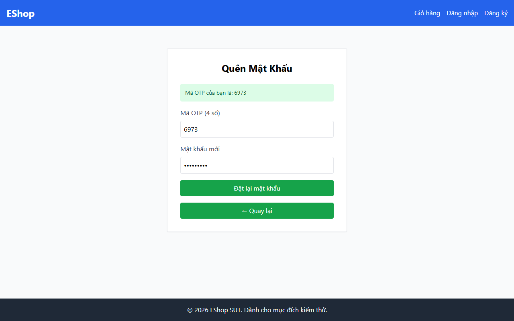

# TC-FORGOT-006: Bước 2 - Đặt lại Mật khẩu với 9 Ký tự (min + 1)

## Requirement ID

FR-03 (Bước 2), FR-01

## Module / Test Type / Technique

PASSWORD-RESET-WEB / Functional / Domain Testing

## Preconditions

- Đã yêu cầu OTP cho `test@eshop.com` ở Bước 1.

## Test Data

| Field | Value |
|---|---|
| `otp` | `<Mã OTP 6 chữ số được tạo>` |
| `new_password` | `Abc1234@!` (9 ký tự) |
| `confirm_password` | `Abc1234@!` (9 ký tự) |

## Test Steps

1. Tại Bước 2, nhập mã OTP 6 chữ số.
2. Nhập `Abc1234@!` vào "Mật khẩu mới".
3. Nhập `Abc1234@!` vào "Xác nhận mật khẩu mới".
4. Gửi biểu mẫu đặt lại mật khẩu.

## Expected Result

- Đặt lại mật khẩu thành công.

## Actual Result

Mật khẩu hợp lệ 9 ký tự "Passw123!" bị regex Client từ chối do chứa ký tự đặc biệt "!" và không có khoảng trắng; hiển thị alert cảnh báo mật khẩu quá yếu.

**Execution report observation:** Bị Client Regex chặn với alert: "Mật khẩu quá yếu!...". Regex cấm ký tự đặc biệt `!`.

## Evidence

## Status / Related Bugs

FAIL / DEF-FR03-05 — see [execution report](../../../reports/test-results/FR-03/domain_testing_report.md).
