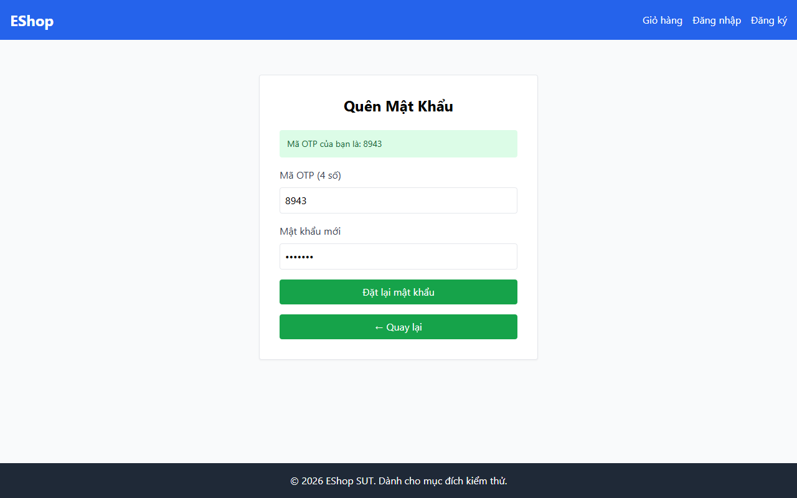

# TC-FORGOT-007: Bước 2 - Vi phạm Biên Độ dài Mật khẩu (7 Ký tự)

## Requirement ID

FR-03 (Bước 2), FR-01

## Module / Test Type / Technique

PASSWORD-RESET-WEB / Functional / Domain Testing

## Preconditions

- Đã yêu cầu OTP cho `test@eshop.com` ở Bước 1.

## Test Data

| Field | Value |
|---|---|
| `otp` | `<Mã OTP 6 chữ số được tạo>` |
| `new_password` | `Abc12@!` (7 ký tự) |
| `confirm_password` | `Abc12@!` (7 ký tự) |

## Test Steps

1. Tại Bước 2, nhập mã OTP hợp lệ.
2. Nhập `Abc12@!` (7 ký tự gồm đủ chữ hoa, thường, số, ký tự đặc biệt).
3. Nhập `Abc12@!` vào ô xác nhận.
4. Gửi biểu mẫu.

## Expected Result

- Hệ thống từ chối yêu cầu do mật khẩu ngắn hơn 8 ký tự.
- Mật khẩu không bị cập nhật.

## Actual Result

Mật khẩu 7 ký tự "Pas12@!" bị chặn thành công với alert: "Mật khẩu quá yếu! Phải dài tối thiểu 8 ký tự, gồm chữ hoa, chữ thường, số và KÝ TỰ ĐẶC BIỆT.".

**Execution report observation:** Hệ thống chặn thành công với alert: "Mật khẩu quá yếu! Phải dài tối thiểu 8 ký tự...".

## Evidence

## Status / Related Bugs

PASS / Không có — see [execution report](../../../reports/test-results/FR-03/domain_testing_report.md).
