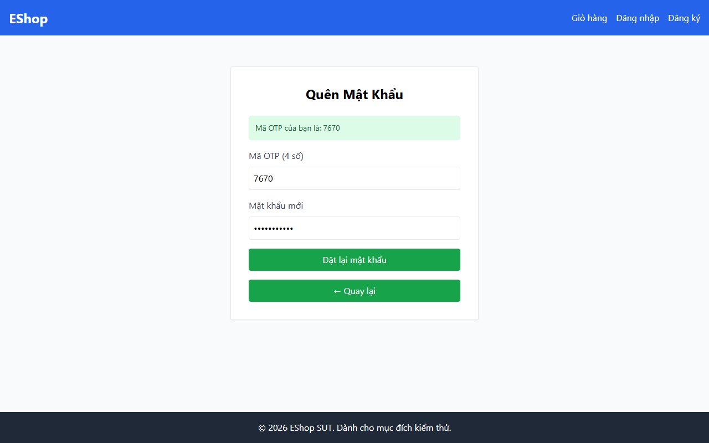

# TC-FORGOT-008: Bước 2 - Mật khẩu Thiếu Chữ hoa

## Requirement ID

FR-03 (Bước 2), FR-01

## Module / Test Type / Technique

PASSWORD-RESET-WEB / Functional / Domain Testing

## Preconditions

- Đã yêu cầu OTP cho `test@eshop.com` ở Bước 1.

## Test Data

| Field | Value |
|---|---|
| `otp` | `<Mã OTP 6 chữ số được tạo>` |
| `new_password` | `abc12345@!` |
| `confirm_password` | `abc12345@!` |

## Test Steps

1. Nhập mã OTP hợp lệ.
2. Nhập `abc12345@!` (có chữ thường, số, ký tự đặc biệt nhưng KHÔNG có chữ hoa).
3. Nhập ô xác nhận trùng khớp.
4. Gửi biểu mẫu.

## Expected Result

- Từ chối với thông báo lỗi yêu cầu mật khẩu phải có ít nhất 1 chữ hoa.

## Actual Result

Mật khẩu thiếu chữ hoa "validpass1!" bị từ chối chính xác với alert: "Mật khẩu quá yếu! Phải dài tối thiểu 8 ký tự...".

**Execution report observation:** Từ chối chính xác với alert: "Mật khẩu quá yếu!...".

## Evidence

## Status / Related Bugs

PASS / Không có — see [execution report](../../../reports/test-results/FR-03/domain_testing_report.md).
