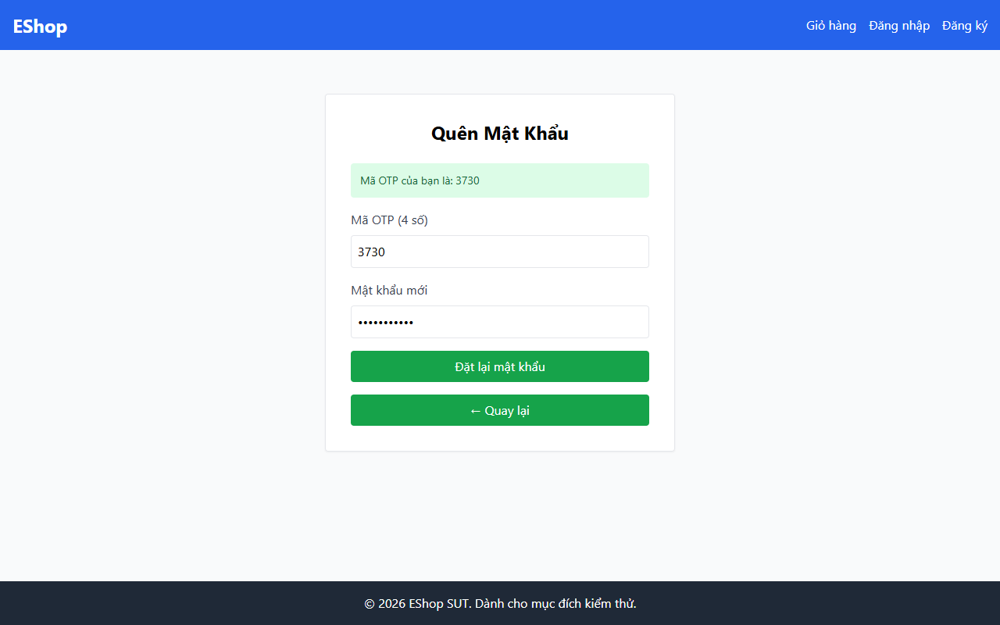

# TC-FORGOT-012: Bước 2 - Mật khẩu Chứa Ký tự Đặc biệt Không Cho Phép

## Requirement ID

FR-03 (Bước 2), FR-01

## Module / Test Type / Technique

PASSWORD-RESET-WEB / Functional / Domain Testing

## Preconditions

- Đã yêu cầu OTP cho `test@eshop.com` ở Bước 1.

## Test Data

| Field | Value |
|---|---|
| `otp` | `<Mã OTP 6 chữ số được tạo>` |
| `new_password` | `Abcdef123#` (`#` không nằm trong tập `@, $, !, %, *, ?, &`) |
| `confirm_password` | `Abcdef123#` |

## Test Steps

1. Nhập mã OTP hợp lệ.
2. Nhập `Abcdef123#`.
3. Nhập ô xác nhận trùng khớp.
4. Gửi biểu mẫu.

## Expected Result

- Hệ thống từ chối vì `#` không thuộc tập hợp ký tự đặc biệt được đặc tả cho phép.

## Actual Result

Mật khẩu chứa ký tự đặc biệt không cho phép "#" ("ValidPass1#") bị từ chối với alert: "Mật khẩu quá yếu! Phải dài tối thiểu 8 ký tự...".

**Execution report observation:** Từ chối với alert: "Mật khẩu quá yếu!...".

## Evidence

## Status / Related Bugs

PASS / Không có — see [execution report](../../../reports/test-results/FR-03/domain_testing_report.md).
