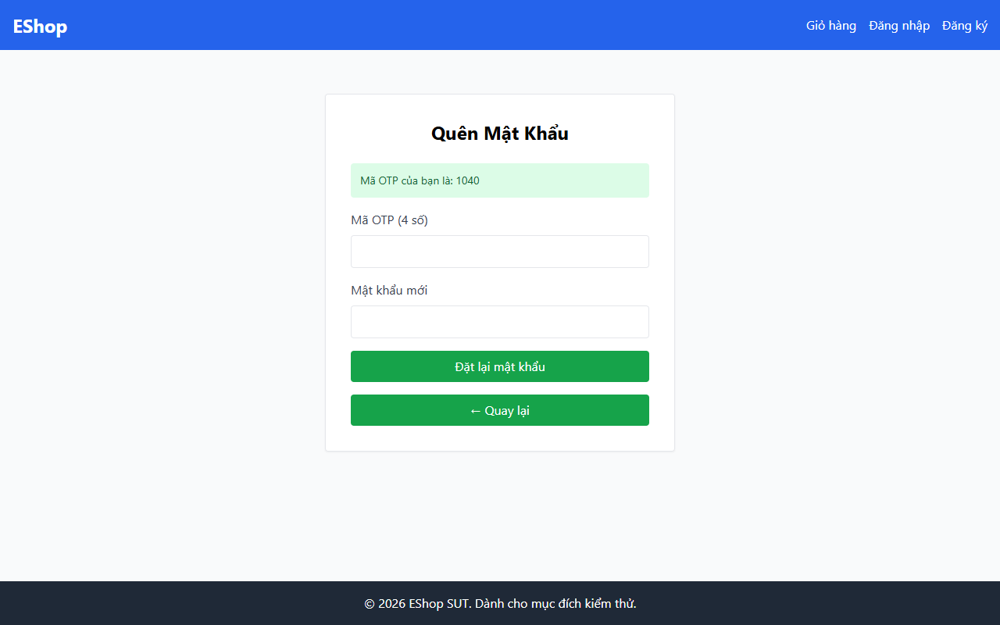

# TC-FORGOT-013: Bước 2 - Mật khẩu và Xác nhận Mật khẩu Không Khớp

## Requirement ID

FR-03 (Bước 2)

## Module / Test Type / Technique

PASSWORD-RESET-WEB / Functional / Domain Testing

## Preconditions

- Đã yêu cầu OTP cho `test@eshop.com` ở Bước 1.

## Test Data

| Field | Value |
|---|---|
| `otp` | `<Mã OTP 6 chữ số được tạo>` |
| `new_password` | `Abc12345@!` |
| `confirm_password` | `Abc12345@?` |

## Test Steps

1. Nhập mã OTP hợp lệ.
2. Nhập `Abc12345@!` vào "Mật khẩu mới".
3. Nhập `Abc12345@?` vào "Xác nhận mật khẩu mới".
4. Gửi biểu mẫu.

## Expected Result

- Hệ thống từ chối với thông báo lỗi hai trường mật khẩu không khớp nhau.

## Actual Result

Giao diện Bước 2 chỉ có đúng 1 trường mật khẩu ("Mật khẩu mới"). Ô "Xác nhận mật khẩu mới" hoàn toàn không tồn tại trong mã nguồn HTML của giao diện.

**Execution report observation:** Bước 2 hoàn toàn không có trường "Xác nhận mật khẩu mới" trong giao diện.

## Evidence

## Status / Related Bugs

FAIL / DEF-FR03-07 — see [execution report](../../../reports/test-results/FR-03/domain_testing_report.md).
