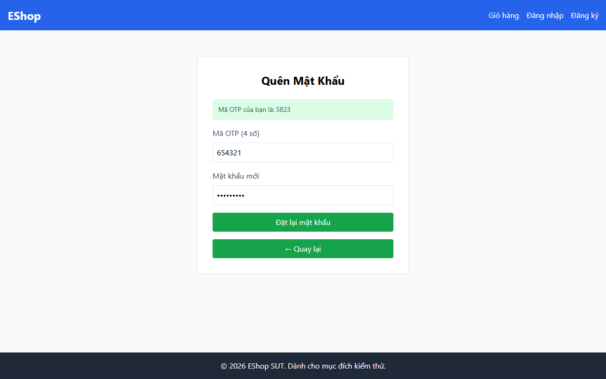

# TC-FORGOT-014: Bước 2 - Mã OTP 6 Chữ số Không Chính Xác

## Requirement ID

FR-03 (Bước 2)

## Module / Test Type / Technique

PASSWORD-RESET-WEB / Functional / Domain Testing

## Preconditions

- Đã yêu cầu OTP cho `test@eshop.com` ở Bước 1.

## Test Data

| Field | Value |
|---|---|
| `otp` | `999999` (không khớp với mã OTP thực tế) |
| `new_password` | `ValidPass1!` |
| `confirm_password` | `ValidPass1!` |

## Test Steps

1. Tại Bước 2, nhập mã OTP sai `999999`.
2. Nhập mật khẩu mới hợp lệ và xác nhận.
3. Gửi biểu mẫu.

## Expected Result

- Hệ thống từ chối yêu cầu với thông báo lỗi mã OTP không đúng. Mật khẩu không bị thay đổi.

## Actual Result

Hệ thống từ chối mã OTP không chính xác ("654321") và hiển thị alert: "Mã OTP không đúng hoặc có lỗi xảy ra.".

**Execution report observation:** Alert: "Mã OTP không đúng hoặc có lỗi xảy ra.". Mật khẩu giữ nguyên.

## Evidence

## Status / Related Bugs

PASS / Không có — see [execution report](../../../reports/test-results/FR-03/domain_testing_report.md).
