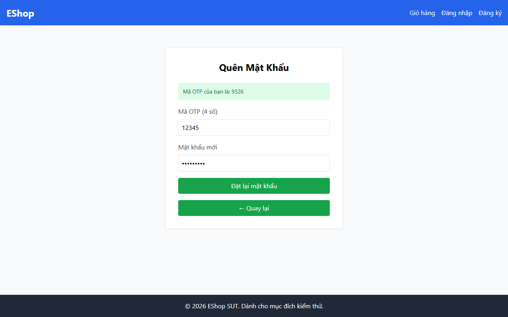

# TC-FORGOT-015: Bước 2 - Biên Độ dài OTP: 5 Chữ số

## Requirement ID

FR-03 (Bước 1, 2)

## Module / Test Type / Technique

PASSWORD-RESET-WEB / Functional / Domain Testing

## Preconditions

- Đã yêu cầu OTP cho `test@eshop.com` ở Bước 1.

## Test Data

| Field | Value |
|---|---|
| `otp` | `12345` (5 chữ số) |
| `new_password` | `ValidPass1!` |
| `confirm_password` | `ValidPass1!` |

## Test Steps

1. Tại Bước 2, nhập mã OTP 5 chữ số `12345`.
2. Nhập mật khẩu mới hợp lệ và xác nhận.
3. Gửi biểu mẫu.

## Expected Result

- Hệ thống từ chối do định dạng/độ dài OTP không hợp lệ (phải đủ 6 chữ số).

## Actual Result

Hệ thống từ chối mã OTP 5 chữ số ("12345") với alert: "Mã OTP không đúng hoặc có lỗi xảy ra.".

**Execution report observation:** Alert: "Mã OTP không đúng hoặc có lỗi xảy ra.".

## Evidence

## Status / Related Bugs

PASS / Không có — see [execution report](../../../reports/test-results/FR-03/domain_testing_report.md).
