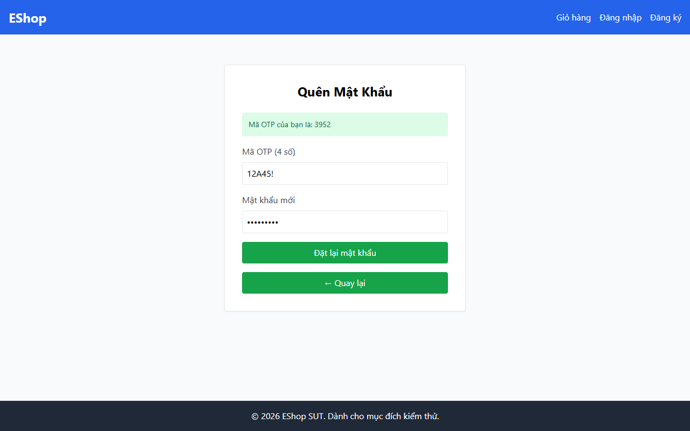

# TC-FORGOT-017: Bước 2 - Mã OTP Chứa Ký tự Không Phải Số

## Requirement ID

FR-03 (Bước 1, 2)

## Module / Test Type / Technique

PASSWORD-RESET-WEB / Functional / Domain Testing

## Preconditions

- Đã yêu cầu OTP cho `test@eshop.com` ở Bước 1.

## Test Data

| Field | Value |
|---|---|
| `otp` | `12A45!` |
| `new_password` | `ValidPass1!` |
| `confirm_password` | `ValidPass1!` |

## Test Steps

1. Tại Bước 2, nhập `12A45!`.
2. Nhập mật khẩu mới hợp lệ và xác nhận.
3. Gửi biểu mẫu.

## Expected Result

- Hệ thống từ chối đầu vào (mã OTP phải là 6 chữ số).

## Actual Result

Hệ thống từ chối mã OTP chứa ký tự chữ và ký tự đặc biệt ("12A45!") với alert: "Mã OTP không đúng hoặc có lỗi xảy ra.".

**Execution report observation:** Alert: "Mã OTP không đúng hoặc có lỗi xảy ra.".

## Evidence

## Status / Related Bugs

PASS / Không có — see [execution report](../../../reports/test-results/FR-03/domain_testing_report.md).
