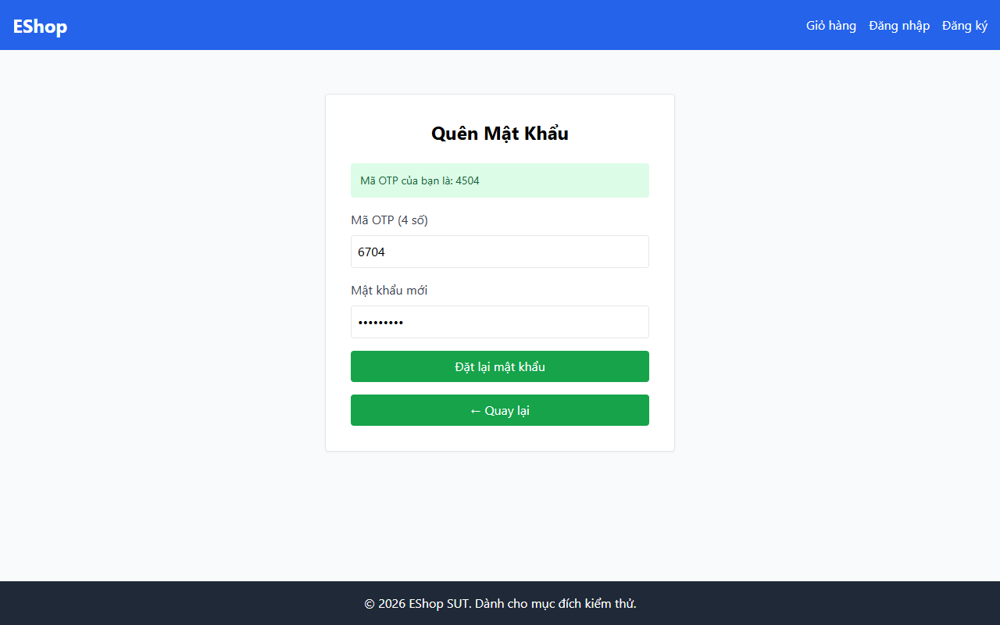

# TC-FORGOT-018: Bước 2 - Cô lập OTP Giữa các Tài khoản (Quy tắc Bảo mật)

## Requirement ID

FR-03 (Bước 2)

## Module / Test Type / Technique

PASSWORD-RESET-WEB / Functional / Domain Testing

## Preconditions

- Người dùng 1 (`test@eshop.com`) yêu cầu mã OTP (ví dụ: OTP-A).
- Người dùng 2 (`admin@eshop.com`) là tài khoản đã đăng ký.

## Test Data

| Field | Value |
|---|---|
| Tài khoản Mục tiêu | `admin@eshop.com` |
| `otp` | OTP-A (tạo cho `test@eshop.com`) |
| `new_password` | `NewPass123!` |
| `confirm_password` | `NewPass123!` |

## Test Steps

1. Khởi tạo quy trình đặt lại mật khẩu cho `test@eshop.com` để nhận OTP-A.
2. Cố gắng gửi yêu cầu đặt lại mật khẩu cho `admin@eshop.com` nhưng dùng mã OTP-A.

## Expected Result

- Hệ thống từ chối yêu cầu; OTP của `test@eshop.com` không có hiệu lực cho `admin@eshop.com`.
- Mật khẩu của tài khoản Admin không bị thay đổi.

## Actual Result

Hệ thống cô lập OTP theo email chuẩn xác; sử dụng OTP của test@eshop.com cho admin@eshop.com bị từ chối với alert: "Mã OTP không đúng hoặc có lỗi xảy ra.".

**Execution report observation:** Alert: "Mã OTP không đúng hoặc có lỗi xảy ra.". Cô lập tài khoản chuẩn xác.

## Evidence

## Status / Related Bugs

PASS / Không có — see [execution report](../../../reports/test-results/FR-03/domain_testing_report.md).
